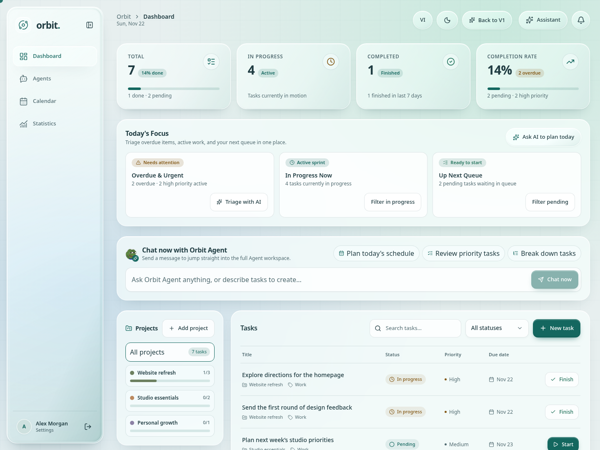
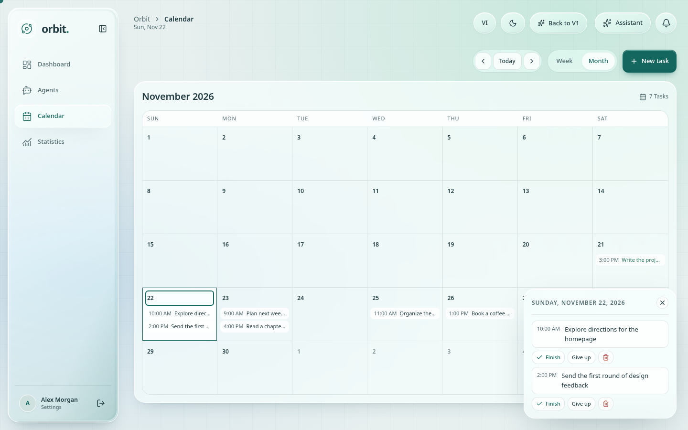
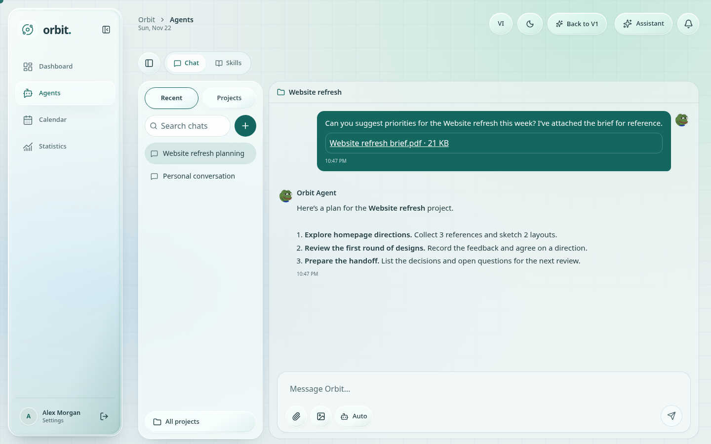
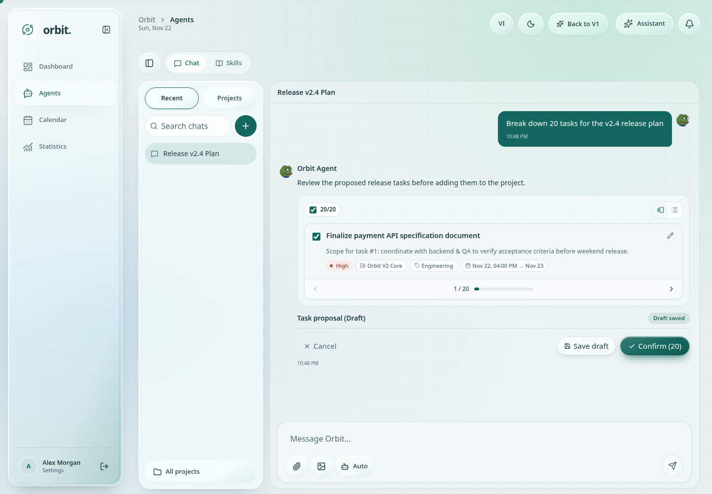

# Orbit

Orbit is a personal workspace for managing tasks, planning deadlines, and working with an AI agent. Organize work by project and category, track progress from the dashboard or calendar, and turn a conversation into tasks you can review before saving.

[Quick start](#quick-start) · [Documentation](#documentation)

## What you can do

### Manage tasks and projects

Set priorities, statuses, and deadlines. Search and filter tasks, track project progress, and review productivity statistics.



### Plan around deadlines

Schedule work in the calendar and get in-app reminders for upcoming and overdue tasks.



### Work with the Orbit Agent

Chat in the Agent Workspace or open the floating assistant from your current page. Group conversations by project, follow live responses and tool activity, and cancel an active run. With private MinIO storage configured, attach files for reference or ask the agent to analyze images.



### Guide the agent and review proposals

Use Auto mode for standard tool-assisted chat or Ask mode to let the agent offer choices when it needs clarification. Review interactive task proposals before applying them and save reusable instructions as personal Markdown skills.



## Quick start

Use **Node.js 22**, **pnpm 11.21.0**, and a **MongoDB replica set or Atlas cluster with transaction support**. Agent chat and other transactional features require this MongoDB configuration. The backend and frontend have separate lockfiles and run independently.

Enable Corepack if needed, then install dependencies from the repository root.

```bash
corepack enable
(cd backend && pnpm install --frozen-lockfile)
(cd frontend && pnpm install --frozen-lockfile)
```

Create the backend environment file on first setup.

```bash
cp backend/.env.example backend/.env
```

Set `MONGO_URI`, `JWT_SECRET`, and `JWT_REFRESH_SECRET` in `backend/.env`. A local replica set named `rs0` listening on port `27017` uses `mongodb://127.0.0.1:27017/?replicaSet=rs0`. Use a different random secret for each JWT setting. The example supplies defaults for token expiry and password hashing, and `MONGO_NAME` selects the database.

Start the API and frontend in separate terminals from the repository root.

```bash
cd backend
pnpm run dev
```

```bash
cd frontend
VITE_SERVER_URL=http://localhost:3001 pnpm run dev
```

Open [Orbit at http://localhost:5000](http://localhost:5000) and create an account. Check API readiness with `curl --fail http://localhost:3001/healthz`. Once signed in, open the V2 workspace at `/v2/dashboard` or the Agent Workspace at `/v2/agents`.

### Optional services

| Feature                        | Configuration                                                                                                                                                                |
| ------------------------------ | ---------------------------------------------------------------------------------------------------------------------------------------------------------------------------- |
| Agent chat and task generation | Add `AI_API_KEY`, `AI_BASE_URL`, and `AI_MODEL_NAME` to `backend/.env` for an OpenAI-compatible provider. Use a model that supports tool calling for agent chat.             |
| Deadline reminders             | Run `pnpm run notifications:worker` from `backend/` in a separate terminal. Docker Compose already starts the worker. [Notification setup](docs/deployment/notifications.md) |
| Private chat attachments       | Configure the `MINIO_*` settings in `backend/.env`. [MinIO setup](docs/deployment/minio.md)                                                                                  |

Restart the API after changing its environment. Task management works without an AI provider.

### Docker Compose

Create and configure `backend/.env` as above. The default Compose stack starts the frontend, API, and notification worker. Supply a MongoDB connection string that the backend container can reach.

```bash
docker compose up --build -d
```

Open [http://localhost:3636](http://localhost:3636). Nginx proxies `/api/` to the backend, which is also exposed at `http://localhost:4000`. Stop the stack with `docker compose down`.

## Architecture

| Component   | Stack and responsibilities                                                                                                               |
| ----------- | ---------------------------------------------------------------------------------------------------------------------------------------- |
| `frontend/` | React 19, TypeScript, Vite, and Tailwind CSS 4. TanStack Query manages server data, and Zustand manages client state.                    |
| `backend/`  | Node.js 22, Express 5, TypeScript, MongoDB/Mongoose, and Zod. Provides the REST API, agent execution, and notification worker.           |
| Agent chat  | Streams response and tool events over Server-Sent Events (SSE). The browser can resume the stream after a reload or disconnect.          |
| Local MCP   | Uses Streamable HTTP on loopback to expose read-only tools for account, task, project, and category data, plus built-in skill resources. |

The REST API is mounted under `/api`. Main route groups include `/api/auth`, `/api/users`, `/api/tasks`, `/api/projects`, `/api/categories`, `/api/stats`, `/api/notifications`, and `/api/ai`.

### Local MCP

Running `pnpm run dev` in `backend/` enables the local MCP endpoint at `http://127.0.0.1:3001/mcp`. Connect a Streamable HTTP client directly over loopback and pass an Orbit `USER` account's access token in the `Authorization: Bearer <token>` header. If the client sends an `Origin` header, add its exact HTTP loopback origin to `MCP_ALLOWED_ORIGINS`. Orbit's built-in agent uses its internal tools independently of this endpoint. [MCP configuration](backend/mcp/config.ts)

To smoke-test the connection, create a task in the account, set `ORBIT_MCP_ACCESS_TOKEN` in your shell, and run `pnpm run mcp:smoke` from `backend/`.

## Development checks

Run the commands from the corresponding package directory.

| Check                | Backend                            | Frontend                                 |
| -------------------- | ---------------------------------- | ---------------------------------------- |
| Automated tests      | `pnpm test`                        | `pnpm test`                              |
| Lint                 | `pnpm run lint`                    | `pnpm run lint`                          |
| Formatting           | `pnpm run format:check`            | `pnpm run format:check`                  |
| Build and type-check | `pnpm run build` (type-check only) | `pnpm run build` (type-check and bundle) |
| Browser tests        |                                    | `pnpm run test:e2e`                      |

For the MCP integration suite, run `pnpm run test:mcp:integration` from `backend/` with `ORBIT_MCP_TEST_MONGO_URI` set to a disposable loopback MongoDB instance. The suite creates and drops its own test database. [Development workflow](docs/workflow.md)

## Documentation

- [Local development and environment variables](docs/development.md)
- [Frontend architecture](docs/architecture/frontend.md) · [Backend architecture](docs/architecture/backend.md)
- [Agent chat architecture](docs/agent-chat-architecture.md) · [Streaming operations](docs/ai/chat-streaming-operations.vi.md)
- [Personal skills](docs/ai/personal-skills.md) · [Interactive task proposals](docs/a2ui-task-proposals.md)
- [CI and deployment](docs/deployment.md)
- [Engineering documentation index](docs/README.md)

## License

The backend package declares the ISC license. [Backend package manifest](backend/package.json)
