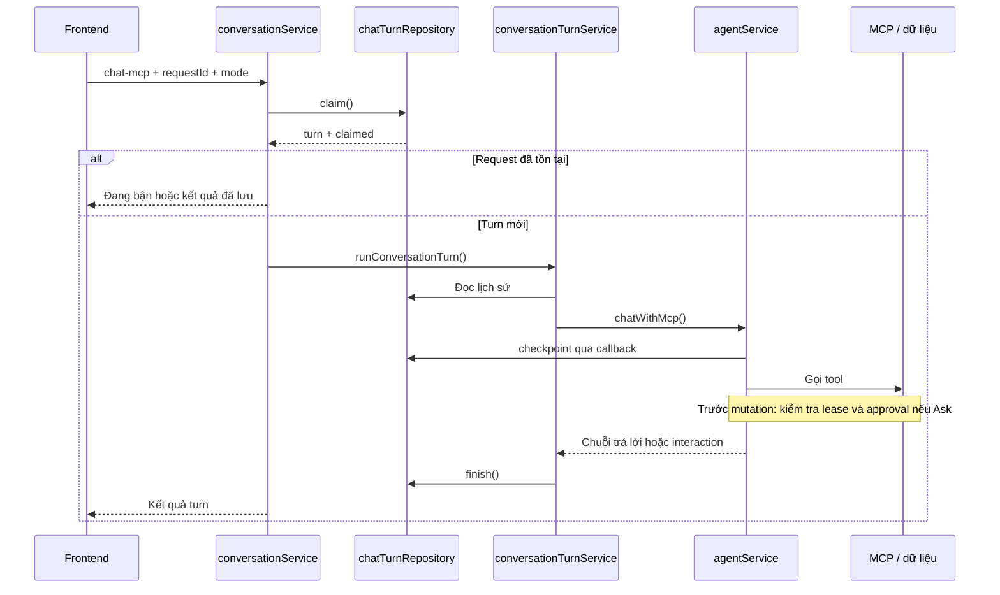

# Giải thích thay đổi nhánh feat/personalize-chat

> **Cập nhật:** Phần mô tả xác nhận ghi bắt buộc bên dưới là thiết kế trước đây. Theo yêu cầu mới, Ask chỉ dùng hướng dẫn mềm trong prompt/description; đã bỏ approval gate, preview fingerprint và tự chèn tool call sau xác nhận. Agent tự tiếp tục và viết câu trả lời sau tool. Xem [kiến trúc hiện tại](../agent-chat-architecture.md).

Ngày đối chiếu: 20/10/2026.

Tài liệu mô tả **code hiện tại trong workspace**, gồm các commit trên nhánh và thay đổi chưa commit, so với `main` tại `cd66793`. HEAD của nhánh khi đọc là `f904b4a`. Các file mới chưa được Git theo dõi cũng được tính vào phần giải thích; chỉ xem `git diff main` sẽ bỏ sót chúng.

Các commit riêng của nhánh tại thời điểm này:

- `2d492ec`: cải thiện hiển thị bảng trong chat.
- `4824be6`: tài liệu thiết kế Auto/Ask.
- `f904b4a`: phiên bản ban đầu của chế độ hỏi người dùng.

Code chưa commit tiếp tục tổ chức lại backend/frontend và chuyển menu sang mô hình trả lời bằng **lượt chat mới**. Vì vậy không nên dùng riêng nội dung commit MVP hoặc kế hoạch thiết kế cũ để suy ra hành vi hiện tại.

## 1. Người dùng nhận được gì?

Nhánh này mở rộng chat có MCP thành trải nghiệm có hai chế độ:

| Chế độ | Hành vi |
| --- | --- |
| Auto | Agent dùng tool để đọc dữ liệu và thực hiện yêu cầu ghi của người dùng theo luồng hiện có. Không bắt buộc đi qua menu xác nhận của Ask. |
| Ask | Agent có thể đưa câu hỏi lựa chọn; mọi thao tác ghi thuộc nhóm write tool phải được backend tạo bản xem trước và yêu cầu xác nhận riêng. |

Ví dụ trong Ask:

1. Người dùng yêu cầu tạo task.
2. Nếu thiếu thông tin, agent đưa menu làm rõ.
3. Người dùng chọn hoặc nhập câu trả lời.
4. Khi chuẩn bị tạo task, backend hiển thị chính xác dữ liệu sẽ ghi.
5. Người dùng xác nhận; backend kiểm tra lại dữ liệu rồi mới thực hiện.

**Trả lời câu hỏi làm rõ không đồng nghĩa với cho phép ghi dữ liệu.** Hai loại interaction có mục đích khác nhau.

Ngoài ra, agent có tool đọc hồ sơ người dùng hiện tại, giao diện có thẻ lựa chọn/xác nhận và bộ hiển thị Markdown hỗ trợ bảng.

## 2. Những phần đã có từ main và phần được bổ sung

`main` đã có conversation memory, phân trang lịch sử, ID request chống gửi lặp, lease 5 phút và checkpoint. Nhánh này không tạo mới toàn bộ cơ chế đó.

| Thành phần | So với main |
| --- | --- |
| Lưu conversation và chat turn | Giữ nền tảng cũ, bổ sung mode, lựa chọn, interaction và dữ liệu kiểm soát thực thi. |
| Chống request trùng | Bổ sung kiểm tra mode và selection vào định danh nội dung request. |
| Quyền xử lý có hạn | Bổ sung execution token và kiểm tra ngay trước khi ghi dữ liệu nghiệp vụ. |
| Repository | Tách thao tác trên turn khỏi repository quản lý conversation. |
| Agent dùng MCP | Tách khỏi `aiService`, thêm chính sách Ask và xác nhận thao tác ghi. |
| Frontend chat | Thêm Auto/Ask, menu, trả lời bằng lượt mới và khôi phục cả selection khi retry. |
| Hồ sơ người dùng | Thêm tool `orbit_get_me`. |
| Render câu trả lời | Thêm bảng Markdown, căn lề và xử lý dấu `\|` trong ô. |

Một số diff chỉ đổi định dạng, ví dụ `frontend/src/shared/services/httpClient.ts`; không nên xem đó là thay đổi logic refresh token.

## 3. Bản đồ backend: đọc file nào để hiểu phần nào?

Các đường dẫn dưới đây tính từ thư mục `backend/`.

| File | Trách nhiệm hiện tại |
| --- | --- |
| `controllers/aiController.ts` | Nhận body đã validate, truyền mode/selection vào service, trả kết quả HTTP. |
| `validations/aiValidation.ts` | Kiểm tra payload chat và cấu trúc selection. |
| `services/conversationService.ts` | Điểm vào của gửi chat, tải lịch sử, nhận quyền xử lý turn. |
| `services/conversationTurnService.ts` | Chạy một turn mới, nối checkpoint/guard, lưu kết quả hoặc xử lý thất bại. |
| `services/agentService.ts` | Tạo kết nối MCP trong bộ nhớ và chạy vòng lặp model/tool. |
| `services/agentInteractionService.ts` | Định nghĩa `grill_user`, tạo preview xác nhận và kiểm tra quyền ghi đã được duyệt. |
| `services/interactionAnswerService.ts` | Kiểm tra lựa chọn và tính trạng thái interaction tiếp theo. |
| `repositories/conversationRepository.ts` | Tạo, tìm, lấy conversation mới nhất. |
| `repositories/chatTurnRepository.ts` | Truy vấn turn, claim, lưu interaction, checkpoint, guard và finish. |
| `utils/agentMessages.ts` | Hoàn tất cặp assistant/tool, đóng menu và chuẩn bị lịch sử. |
| `utils/conversationView.ts` | Chuyển dữ liệu lưu trữ thành dữ liệu công khai cho frontend. |
| `types/IAgent.ts`, `types/IChatTurn.ts` | Kiểu dữ liệu dùng chung. |
| `libs/aiProvider.ts` | Parse JSON bằng schema và chuẩn hóa lỗi provider. |

`aiService.ts` giữ chức năng chat đơn giản và sinh task; phần agent có tool chuyển sang `agentService.ts`. File `agentInteraction.ts` của bản MVP được thay bằng các module có trách nhiệm cụ thể hơn.

## 4. Luồng một tin nhắn bình thường



Mỗi request tạo MCP server/client riêng bằng `InMemoryTransport`, mang context người dùng đã xác thực. Không cần gọi HTTP vòng về chính ứng dụng. Kết nối được đóng trong `finally`.

Agent lưu tiến trình quanh các lần gọi provider/tool. Ask đặt `parallel_tool_calls: false`; backend vẫn xử lý trường hợp model trả về nhiều tool call bằng cách đóng các call còn lại khi một menu xuất hiện.

## 5. Vòng đời menu: hoàn tất lượt cũ, tạo lượt mới

Đây là thay đổi quan trọng so với cách pause/resume của bản MVP.

Khi agent cần hỏi:

1. `grill_user` tạo interaction loại `clarification`, có 2–4 lựa chọn với ID không trùng.
2. `completeMenuMessages()` tạo kết quả tool cho những call còn thiếu kết quả.
3. Call tạo menu được đánh dấu đã hiển thị câu hỏi, chưa thực thi hành động; những call còn lại bị đánh dấu bỏ qua.
4. Turn được lưu là `completed`, chứa interaction `pending`.
5. Conversation được giải phóng để nhận lượt tiếp theo.

Khi người dùng trả lời:

1. Frontend gửi một request chat mới, có `requestId` mới và `selection` trỏ tới interaction.
2. Trong transaction claim, backend đọc menu hiện tại và gọi `prepareInteractionSelection()`.
3. Backend lưu interaction cũ thành `answered` hoặc `cancelled`, đồng thời tạo turn mới.
4. Nếu đó là xác nhận ghi hợp lệ, turn mới nhận hành động đã được duyệt để xử lý.

Việc đọc menu, kiểm tra câu trả lời và đánh dấu đã sử dụng nằm trong cùng transaction. Điều này tránh hai request đồng thời cùng tiêu thụ một menu.

Nếu người dùng gửi văn bản thường khi còn menu, interaction cũ bị hủy và văn bản đó trở thành yêu cầu mới. Gõ “đồng ý” dưới dạng văn bản thường **không tự cấp approval** cho thao tác đã lưu.

Dữ liệu cũ có trạng thái `awaiting_user` vẫn được hỗ trợ. Khi tiêu thụ menu cũ, backend hoàn tất transcript và chuyển lượt đó sang `completed`, không mở lại tool call cũ để chạy tiếp.

## 6. Ask bảo đảm chỉ ghi đúng thao tác đã xác nhận như thế nào?

Trong `agentInteractionService.ts`, `confirmation()`:

- Kiểm tra role và scope `tasks:write`.
- Validate đối số bằng schema của tool create/update.
- Đọc task và các tham chiếu category/project trong context người dùng.
- Điền các giá trị mặc định trước khi hiển thị preview.
- Lưu đối số cụ thể và fingerprint của hành động, cùng fingerprint dữ liệu xem trước.

Ví dụ khi tạo task trong Ask, các giá trị thiếu được cố định như priority `Medium`, description rỗng, project `null`, startDate đầu ngày, dueDate `null` và category mặc định. Đây là giá trị thực tế được chuẩn bị trong code xác nhận; không nên suy ra chỉ từ mô tả của schema tool.

Sau khi người dùng chọn “Xác nhận”:

1. Agent tạo cặp assistant/tool mới cho **đối số đã lưu**, trước khi hỏi model tiếp.
2. `resolveWriteApproval()` kiểm tra interaction, tool, lựa chọn và fingerprint.
3. Backend dựng lại preview từ dữ liệu hiện tại. Nếu đã thay đổi, trả menu xác nhận mới.
4. Ngay trong transaction ghi, callback `beforeWrite` kiểm tra preview thêm lần nữa.
5. Nếu dữ liệu đổi ở thời điểm cuối này, thao tác bị chặn bằng `STALE_APPROVAL`.

Việc kiểm tra lần đầu có thể trả menu mới trực tiếp; kiểm tra cuối trong transaction chặn mutation nếu approval đã lỗi thời. Không nên coi hai nhánh đó là cùng một kiểu phản hồi UI.

Approval gắn với một hành động cụ thể. Một tool ghi khác tiếp theo cần xác nhận riêng. `publicInteraction()` không gửi đối số approval hoặc fingerprint nội bộ xuống frontend.

## 7. ChatTurn repository và các lớp chống chạy lặp

| Hàm | Ý nghĩa |
| --- | --- |
| `pendingMenu()` | Tìm turn mới nhất có interaction pending. |
| `turns()` | Lấy lịch sử theo cursor sequence. |
| `active()` | Tìm turn đang được conversation tham chiếu, có kiểm tra user/conversation. |
| `claim()` | Chống request lặp, nhận quyền xử lý conversation, tiêu thụ menu và tạo turn mới trong transaction. |
| `checkpoint()` | Lưu toàn bộ messages khi turn vẫn processing, còn hạn và đúng token nếu được truyền. |
| `guardExecution()` | Kiểm tra token, thời hạn và quyền giữ conversation trước mutation nghiệp vụ. |
| `finish()` | Lưu kết quả và giải phóng conversation trong cùng transaction. |

Các ID có vai trò khác nhau:

| Giá trị | Vai trò |
| --- | --- |
| `requestId` | Nhận diện một lần gửi logic của client; retry phải giữ nguyên payload và ID này. |
| Turn `_id` | SHA-256 từ userId và requestId, để tìm cùng một lượt khi gửi lại. |
| `executionToken` | Nhận diện quyền thực thi của tác vụ xử lý turn. |
| `idempotencyKey` của tool | Chống thực hiện lại mutation nghiệp vụ, dựa trên receipt của MCP đã có. |

`guardExecution()` tăng `executionRevision` trên conversation. Việc ghi này tạo điểm xung đột với thao tác claim khác trong transaction, thay vì chỉ đọc trạng thái rồi ghi nghiệp vụ sau đó.

Lease là 5 phút và checkpoint không gia hạn lease. Turn hết hạn không được tự chạy lại với cùng request ID. `resultFor()` có thể trả trạng thái failed cho turn processing đã hết hạn mà không nhất thiết cập nhật trạng thái đó trong database.

`finish()` chỉ ghi nếu turn còn processing, còn hạn và khớp token khi được truyền; nếu không khớp thì bỏ qua. Điều này ngăn tác vụ cũ lưu kết quả muộn và giải phóng quyền của luồng mới.

Hủy hoặc thất bại của lượt chat không hoàn tác những tool đã ghi thành công ở trước đó. Receipt của tool và lịch sử giúp tránh lặp lại các hành động ấy.

## 8. Lịch sử hội thoại và dữ liệu công khai

`prepareHistory()` giữ ranh giới turn và cặp assistant/tool hợp lệ. Nếu một tool call thiếu kết quả do gián đoạn, lịch sử được bổ sung thông báo rằng kết quả thực thi chưa rõ, yêu cầu đọc dữ liệu hiện tại trước khi hành động lại.

Runner lấy tối đa 20 turn trước đó; helper giới hạn lịch sử theo khoảng 60.000 ký tự JSON và không cắt ngang một turn. Đây là giới hạn ký tự, không phải số token.

API tải lịch sử lấy 51 turn để biết còn trang tiếp theo hay không, rồi hiển thị tối đa 50 turn. `conversationView.ts` dựng tin nhắn và interaction cho frontend, không công khai transcript tool hay metadata approval.

## 9. API hiện tại

Tin nhắn thường, trả lời lựa chọn và hủy đều dùng `POST /api/ai/chat-mcp`. So với main, route chat được mở rộng payload; các endpoint trả lời/hủy riêng của bản MVP không còn trong phiên bản hiện tại.

Ví dụ payload trả lời một menu xác nhận:

```json
{
  "conversationId": "11111111-1111-4111-8111-111111111111",
  "requestId": "22222222-2222-4222-8222-222222222222",
  "userInput": "Xác nhận",
  "mode": "ask",
  "selection": {
    "interactionId": "33333333-3333-4333-8333-333333333333",
    "optionId": "confirm"
  }
}
```

`selection` phải chứa đúng một trong `optionId`, `customAnswer`, hoặc `cancel: true`. Service còn kiểm tra option có thuộc menu hiện tại không, menu có cho nhập tự do không và selection có đi với Ask không.

`customAnswer` chỉ dùng cho clarification cho phép nhập tự do. Confirmation không nhận câu trả lời tùy ý để thay đổi đối số đã duyệt.

## 10. Frontend được tổ chức lại ra sao?

Các file tính từ `frontend/src/`:

| File | Trách nhiệm |
| --- | --- |
| `features/tasks/hooks/useConversationChat.ts` | Gửi tin, trả lời/hủy menu, retry và khóa đổi mode khi đang xử lý hoặc cần phục hồi. |
| `features/tasks/hooks/useConversationSession.ts` | Tải conversation, khôi phục trạng thái, phân trang và chặn cập nhật từ phiên đăng nhập cũ. |
| `features/tasks/components/chat/ChatField.jsx` | Ô nhập và điều khiển chế độ chat. |
| `features/tasks/components/chat/InteractionCard.jsx` | Hiển thị câu hỏi, lựa chọn, chi tiết preview và nhập câu trả lời tùy chỉnh. |
| `features/tasks/components/chat/SmallChat.jsx` | Ghép lịch sử, interaction và thao tác của giao diện chat. |
| `features/tasks/components/chat/MarkdownText.jsx` | Render nội dung và bảng Markdown. |
| `shared/types/domain.ts` | Contract mode, interaction, selection, payload và response. |

Khi lỗi mạng khiến chưa biết request đã chạy xong chưa, hook giữ `pending` và retry cùng payload, bao gồm cả selection. Không tạo request ID mới cho cùng lần gửi chưa rõ kết quả.

Session hook kiểm tra `sessionRevision` để bỏ qua phản hồi đến muộn từ tài khoản trước, và dùng `loadVersion` để tránh kết quả tải cũ ghi đè lần tải mới hơn. Mode và menu pending được khôi phục từ server.

Bộ render Markdown hiện tại là parser nhỏ cho văn bản, chữ đậm và bảng; không phải bộ Markdown đầy đủ. Bảng có cuộn ngang, căn lề từ separator và hỗ trợ dấu pipe được escape.

## 11. Cá nhân hóa bằng orbit_get_me

Tool mới nằm tại `backend/mcp/tools/users/getMe.ts`, đọc hồ sơ của chính user trong context xác thực. Nó không nhận userId từ model.

Kết quả được giới hạn bằng schema: id, name, email, role, dob, nationality và avatarUrl. Prompt yêu cầu agent dùng tool khi cần biết hồ sơ, không tự đoán; văn bản trong hồ sơ được xem là dữ liệu, không phải chỉ dẫn.

Tool này cung cấp dữ liệu hồ sơ hiện tại. Nó không đồng nghĩa với việc nhánh đã có một hệ thống tự học sở thích dài hạn.

## 12. Test và phạm vi xác minh của tài liệu

Các test hiện có trong workspace mô tả những tình huống quan trọng:

| File test | Tình huống tiêu biểu |
| --- | --- |
| `backend/services/test/agentService.test.ts` | Menu kết thúc turn, thực thi đúng đối số đã duyệt, preview lỗi thời, kiểm tra lại trong transaction. |
| `backend/services/test/conversationService.integration.test.ts` | Request đồng thời, selection retry, menu thành turn mới, lease hết hạn, dữ liệu awaiting_user cũ và không chạy lại approval đã sử dụng. |
| `backend/mcp/test/writes.integration.test.ts` | Luồng ghi có guard trong transaction. |
| `frontend/src/features/tasks/components/test/ChatBubble.test.jsx` | Khôi phục mode/menu, retry cùng ID, hủy bằng chat mới, nhập câu trả lời và bỏ qua phản hồi tài khoản cũ. |
| `frontend/src/features/tasks/components/test/MarkdownText.test.jsx` | Hiển thị bảng Markdown. |

Tài liệu này được viết bằng cách đối chiếu Git và đọc implementation/test; **không chạy lại test, build hay gọi AI provider trong lần viết tài liệu này**. Việc liệt kê test là mô tả phạm vi test đã có, không phải khẳng định tất cả đang pass. Các con số kiểm thử trong tài liệu kiến trúc trước đó không được xem là kết quả kiểm chứng mới.

## 13. Thứ tự đọc code gợi ý

1. Đọc [conversationService.ts](../../backend/services/conversationService.ts) để hiểu điểm vào.
2. Đọc [chatTurnRepository.ts](../../backend/repositories/chatTurnRepository.ts) để hiểu claim và dữ liệu lưu.
3. Đọc [conversationTurnService.ts](../../backend/services/conversationTurnService.ts) để thấy cách chạy một lượt.
4. Đọc [agentService.ts](../../backend/services/agentService.ts) để theo vòng lặp model/tool.
5. Đọc [agentInteractionService.ts](../../backend/services/agentInteractionService.ts) cùng [interactionAnswerService.ts](../../backend/services/interactionAnswerService.ts) để hiểu xác nhận và câu trả lời.
6. Đọc [useConversationChat.ts](../../frontend/src/features/tasks/hooks/useConversationChat.ts) cùng [useConversationSession.ts](../../frontend/src/features/tasks/hooks/useConversationSession.ts) để nối với frontend.

Tài liệu liên quan: [bản đồ kiến trúc agent hiện tại](../agent-chat-architecture.md), [conversation memory](conversation-memory.md), [thiết kế Auto/Ask](../superpowers/specs/2026-10-19-agent-auto-ask-design.md). Khi tài liệu kế hoạch khác implementation, mô tả luồng ở trên ưu tiên code đã đọc tại thời điểm ghi nhận.
