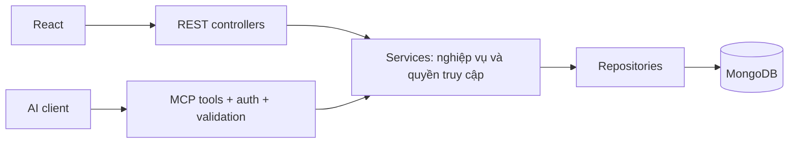

# Orbit MCP — Roadmap theo phase

Ngày: 2026-10-16. Trạng thái: phase 1–2 hoàn thành ngày 2026-10-16; `/mcp` chỉ local, mặc định tắt; phase 3–5 chưa triển khai.

Mục tiêu: cho AI client truy cập công việc của đúng người dùng trong Orbit qua MCP, tái sử dụng nghiệp vụ backend hiện có.

## Quyết định kiến trúc

Thêm adapter MCP bằng TypeScript trong backend Express. REST controller và MCP tool cùng gọi service; service tiếp tục gọi repository. Không gọi REST qua HTTP nội bộ, không đưa truy vấn MongoDB vào tool handler. Endpoint dự kiến `/mcp`, dùng Streamable HTTP; ưu tiên xử lý không lưu session nếu SDK/client đã chọn hỗ trợ.

Các phương án đã cân nhắc:

| Phương án | Lợi ích | Chi phí | Quyết định |
| --- | --- | --- | --- |
| MCP cùng backend, gọi service | Dùng chung nghiệp vụ, một deployment | Scale chung với API | Chọn cho phiên bản đầu |
| MCP riêng, gọi REST API | Độc lập deployment | Thêm hop mạng, quản lý credential upstream | Xem xét khi có yêu cầu vận hành riêng |
| MCP riêng, truy cập MongoDB | Linh hoạt truy vấn | Dễ nhân đôi/bỏ qua nghiệp vụ và phân quyền | Không chọn |

## Các phase và điều kiện chuyển tiếp

| Phase | Phạm vi | Đầu ra | Điều kiện hoàn thành |
| --- | --- | --- | --- |
| 1 — Nền tảng phân quyền task | Sửa việc filter ghi đè quyền trong `getAll`; kiểm thử user A/B, admin, phân trang | Bản sửa service và test hồi quy; không thêm endpoint MCP | Không lộ task hoặc số lượng task ngoài quyền trong ma trận test; build và regression pass |
| 2 — MCP chỉ đọc trong môi trường phát triển | SDK, transport, context theo request, validation, DTO và lỗi; `orbit_list_tasks`, `orbit_get_task`, `orbit_list_projects`, `orbit_list_categories` | `/mcp` bật bằng cấu hình; mặc định tắt; client thử nghiệm kết nối được | Khởi tạo, khám phá và gọi tool thành công; token sai/hết hạn bị từ chối; request đồng thời không lẫn người dùng |
| 3 — Xác thực remote nhiều người dùng | OAuth-compatible authorization server, resource metadata, discovery, audience, issuer, expiry, scopes; ánh xạ subject sang Orbit user | Kết nối remote trên staging với đăng nhập từng người dùng | Client mục tiêu hoàn thành đăng nhập; thiếu quyền trả lỗi; không chấp nhận token cho resource khác |
| 4 — Thao tác ghi | `orbit_create_task`, `orbit_update_task`, `orbit_start_task`, `orbit_complete_task`, `orbit_give_up_task`; scope ghi, audit và xử lý retry | Quản lý vòng đời task qua AI | Nghiệp vụ/stats đúng; retry tạo task không nhân đôi theo hợp đồng idempotency đã định; kiểm thử chéo người dùng |
| 5 — Phát hành và vận hành | HTTPS/proxy `/mcp`, rate limit, giới hạn payload, timeout, metrics, deployment/rollback, đánh giá workflow | MCP production và hướng dẫn kết nối | Smoke test qua URL thực, kiểm thử tải theo ngân sách thống nhất, 10 tình huống đánh giá trên fixture ổn định đạt kỳ vọng |

Thứ tự phụ thuộc: **1 → 2 → 3 → 4 → 5**. Mỗi phase có spec và plan riêng trước khi triển khai. Phase 1 là điều kiện bắt buộc trước khi mở dữ liệu qua MCP.

## Ranh giới xác thực và dữ liệu

- Phase 2 chỉ chạy local/test, không public. Có thể dùng Orbit JWT qua header cho client thử nghiệm có hỗ trợ, nhưng đây không phải tuyên bố tương thích OAuth MCP. Nếu dùng HTTP local, bind loopback và kiểm tra Origin. Context user lấy từ token đã xác thực ở mỗi request, không lấy từ arguments hoặc biến toàn cục.
- Phase 3 thay đường xác thực thử nghiệm bằng luồng remote chuẩn; scopes dự kiến `tasks:read`, `projects:read`, `categories:read`, `tasks:write`. Không truyền token nhận từ MCP client sang API upstream. Không mặc định cấp quyền admin cho tool.
- REST giữ chính sách admin hiện hành. Trước phase 2, thiết kế context MCP phải chặn việc tài khoản admin vô tình dùng quyền đọc toàn hệ thống cho yêu cầu “task của tôi”; phiên bản đầu không cung cấp tool quản trị toàn hệ thống.
- MCP dùng Zod ở biên tool, kể cả khi gọi service trực tiếp. Chuẩn hóa output thành DTO tối thiểu; repository hiện populate tên/email chủ sở hữu nên không trả thẳng Mongoose document.
- Giữ phân trang theo `pageNo`, `pageSize` và `pageInfo` của hệ thống; giới hạn tối đa 100. Mô tả rõ khoảng hạn là `dueDate`, múi giờ và trường hợp không có dữ liệu.
- Tool ghi chuyển trạng thái gọi service chuyên biệt. Không mở `status` qua tool sửa nội dung. Cần kiểm tra hành vi retry và tính nhất quán stats trước khi công bố tool.

## Giới hạn và quyết định ở phase sau

- Phase 1 không sửa timezone, OAuth, mô hình ownership, dữ liệu lịch sử hoặc thống kê.
- Trước phase 2, chọn client mục tiêu và khóa phiên bản SDK/protocol qua thử nghiệm tương thích; không dùng tài liệu draft làm hợp đồng mặc định.
- `getStats` hiện rebuild và lưu dữ liệu khi đọc: cần đánh giá side effect trước khi bổ sung tool thống kê và `readOnlyHint`.
- Tool xóa, batch generation bằng LLM, resources, prompts và subscriptions nằm ngoài phiên bản đầu; thêm khi có use case cụ thể.
- Không cần sửa frontend để AI client bên ngoài dùng MCP. Nếu muốn chat tích hợp trong Orbit gọi MCP, lập thiết kế orchestration riêng.

## Tài liệu phase 1

- [Spec phase 1](../specs/2026-10-16-orbit-mcp-phase-1-design.md)
- [Implementation plan phase 1](2026-10-16-orbit-mcp-phase-1.md)

## Tài liệu phase 2

Phase 2 đã triển khai và nghiệm thu ngày 2026-10-16: SDK 1.32.1/protocol 2025-11-25; 142 backend tests pass với MongoDB integration thật và Inspector 2.11.0 Web UI smoke pass. ADMIN bị từ chối trong MCP; không mở public hoặc OAuth. [Hướng dẫn local](../../mcp/local-development.md).

- [Spec phase 2](../specs/2026-10-16-orbit-mcp-phase-2-design.md)
- [Implementation plan phase 2](2026-10-16-orbit-mcp-phase-2.md)

## Nguồn kỹ thuật

Tham chiếu phiên bản cụ thể để tránh trộn hợp đồng giữa các bản; kiểm tra lại khi thực hiện phase 2–3.

- [MCP transports, bản 2025-11-25](https://modelcontextprotocol.io/specification/2025-11-25/basic/transports): stdio và Streamable HTTP, endpoint và bảo vệ Origin.
- [MCP authorization, bản 2025-11-25](https://modelcontextprotocol.io/specification/2025-11-25/basic/authorization): discovery, OAuth và xác thực token theo resource.

Các lựa chọn chia phase, tool và cách dùng service ở trên là đề xuất riêng cho Orbit dựa trên code hiện tại.
