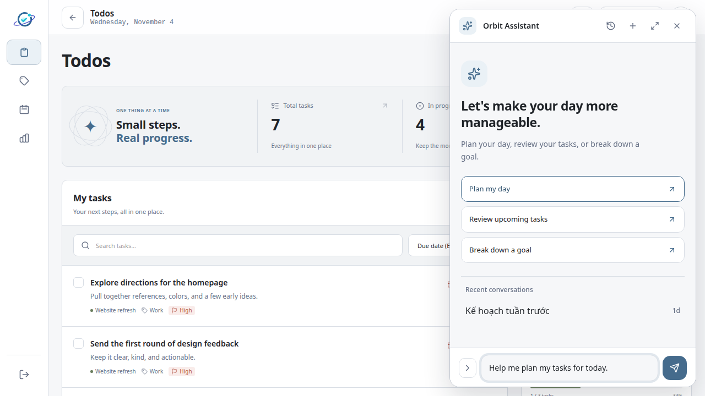
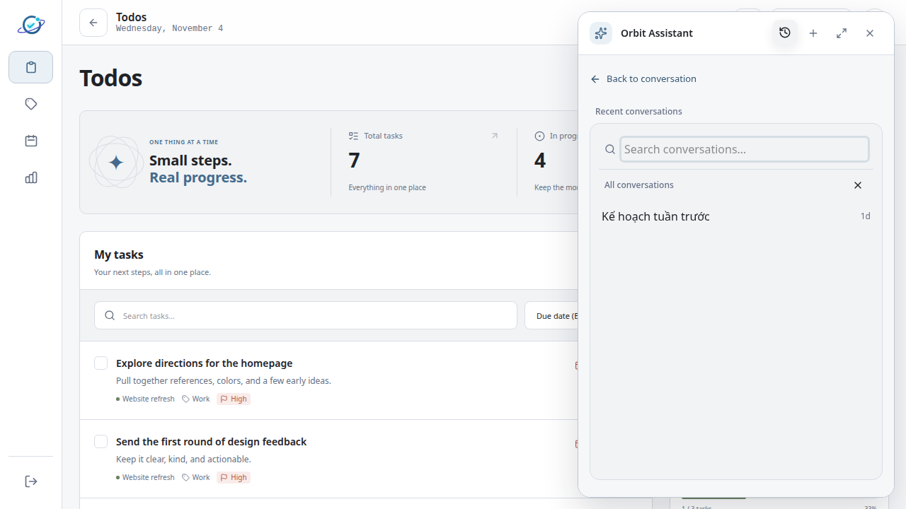
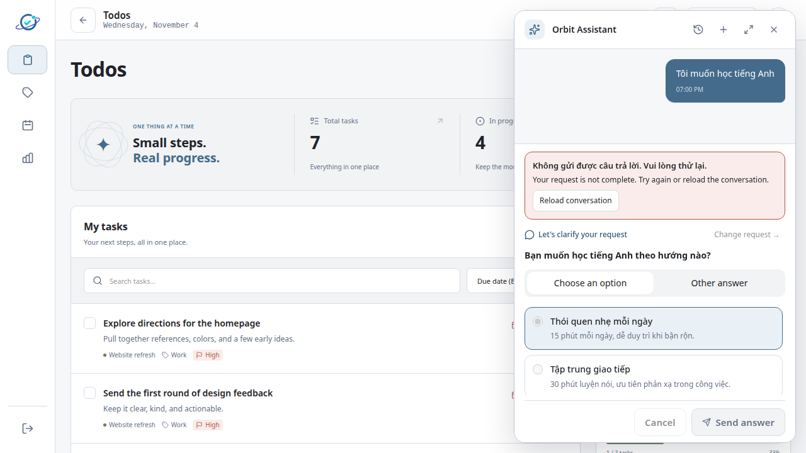
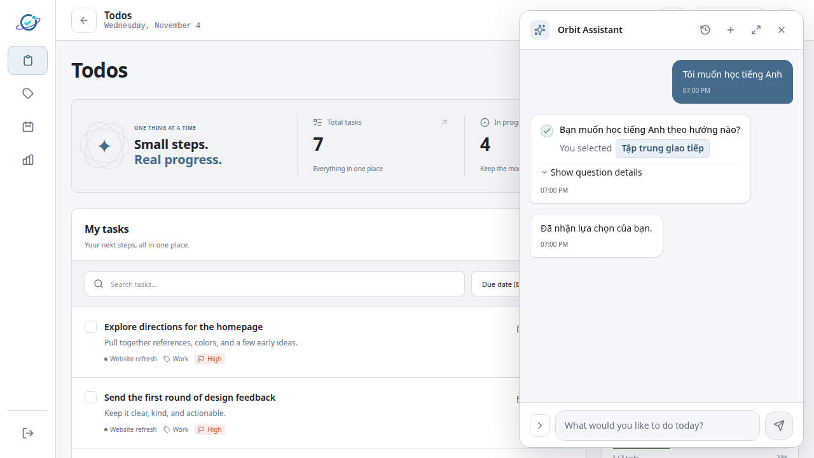
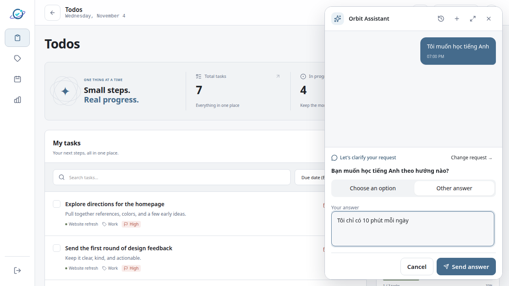
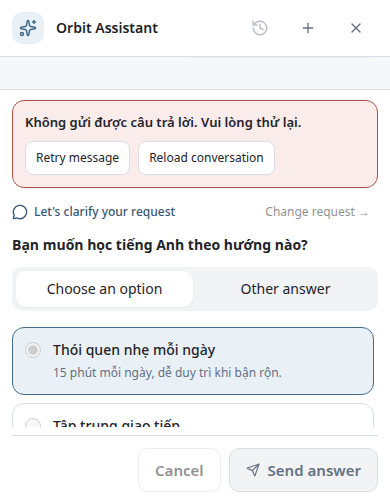
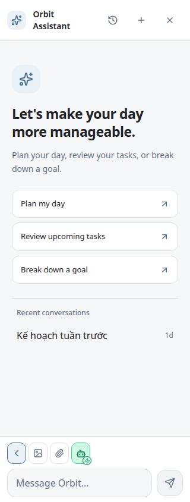
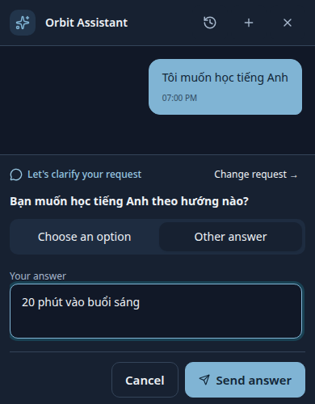
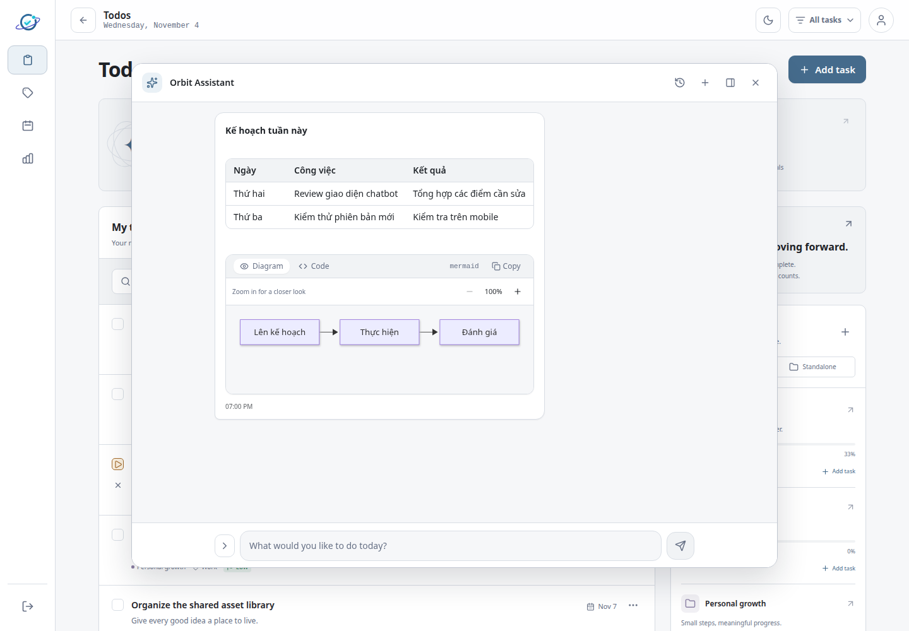
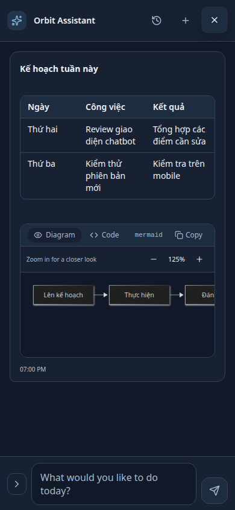

# Chatbot sau cải thiện — 04/11/2026

Đã cải thiện giao diện, thao tác lại như người dùng và sửa tiếp các lỗi phát hiện qua screenshot. Tôi hài lòng với độ rõ ràng và khả năng phục hồi của bản này trong phạm vi frontend đã kiểm chứng.

## Thay đổi và đánh giá

- **Ask phản ánh đúng kết quả:** chỉ hoàn tất khi server xác nhận. Lỗi 422 cho phép tải lại rồi sửa câu trả lời; lỗi 503 thử lại với cùng request ID. Trả lời khác, hủy và đổi yêu cầu gửi đúng loại dữ liệu riêng. Không còn dấu thành công giả khi gửi thất bại.
- **Soạn tin thoải mái hơn:** Auto/Ask luôn hiện rõ, có mô tả; hội thoại mới giữ chế độ đang chọn. Công cụ nằm ở hàng riêng; mở tệp/skill không bóp ô nhập. Có gợi ý khởi đầu, hỗ trợ Enter khi gõ IME và giữ bản nháp khi gửi thất bại.
- **Lịch sử dễ tìm:** truy cập ngay trên header, có tìm kiếm; mở rồi đóng lịch sử giữ nội dung và tệp đang soạn. Chuyển thành công sang hội thoại khác xóa bản nháp cũ đúng lúc.
- **Mobile:** toàn màn hình, xử lý safe area, không tràn ngang ở 320/390 px; Tab nằm trong chat, đóng trả focus về launcher. Đã sửa lớp header che chat khi dock và nút Ask bị cắt trên viewport cao 500 px.
- **Nội dung:** tiếng Anh thống nhất theo yêu cầu mới, phân biệt nút vô hiệu hóa, khối nội dung thoáng hơn ở chế độ mở rộng; sơ đồ theo theme và zoom/reset 100–200%.

Tự đánh giá: luồng chính nay dễ nhận biết và các lỗi có đường phục hồi rõ. Phần đáng tin cậy nhất là Ask không còn báo hoàn tất trước server. Ở màn hình rất thấp, danh sách lựa chọn phải cuộn để giữ nút hành động trong viewport; đây là giới hạn không gian đã kiểm tra, cần tiếp tục xác nhận với bàn phím ảo trên thiết bị thật.

## Screenshot sau cải thiện

Ảnh chụp frontend thật trong Chromium, phản hồi API được giả lập có kiểm soát. Ảnh tắt animation để tránh bắt trạng thái chuyển tiếp.

### Bắt đầu và lịch sử




### Ask và phục hồi lỗi






### Mobile và nội dung phong phú






Các ảnh bổ sung: [mobile 390px](after/05-mobile-390-attachments.png), [skill 320px](after/06-mobile-320-skills.png), [skill 390px](after/06-mobile-390-skills.png), [dock](after/10-docked-rich-content.png). Đối chiếu [audit ban đầu](README.md) và [Ask trước sửa](ASK-REVIEW.md).

## Kiểm chứng

Các lệnh dưới chạy từ package tương ứng:

| Thư mục  | Lệnh                                                                                            | Kết quả                                              |
| -------- | ----------------------------------------------------------------------------------------------- | ---------------------------------------------------- |
| frontend | `pnpm exec playwright test e2e/chat-usability.spec.ts e2e/chat-attachments.spec.ts --workers=2` | 12 passed                                            |
| frontend | `pnpm test`                                                                                     | 194 passed; 1 lỗi có sẵn ở Calendar                  |
| frontend | `pnpm run lint`                                                                                 | Đạt                                                  |
| frontend | `pnpm exec prettier --check <các tệp thay đổi>`                                                 | Đạt; chỉ format phạm vi thay đổi                     |
| frontend | `pnpm run build`                                                                                | Type-check và bundle đạt; còn cảnh báo chunk >500 kB |
| backend  | `pnpm test`                                                                                     | 224 passed, 49 skipped                               |
| backend  | `pnpm run build`                                                                                | Type-check đạt                                       |
| root     | `git diff --check`                                                                              | Đạt                                                  |

Lỗi frontend là `CalendarTaskDetailCard.test.jsx:60`, kiểm tra thứ tự description/status trong DOM. Đã tái hiện trên bản HEAD tách riêng bằng:

```sh
mkdir -p /tmp/todoapp-baseline-check
git archive HEAD frontend | tar -x -C /tmp/todoapp-baseline-check
ln -s /home/bonxom/Code/TodoApp/frontend/node_modules /tmp/todoapp-baseline-check/frontend/node_modules
cd frontend
pnpm exec vitest run --root /tmp/todoapp-baseline-check/frontend --config /tmp/todoapp-baseline-check/frontend/vitest.config.ts src/features/calendar/components/test/CalendarTaskDetailCard.test.jsx
```

Kết quả baseline: 3 passed, cùng 1 failed. Không sửa Calendar ngoài phạm vi. 49 backend integration tests bỏ qua vì thiếu `ORBIT_MCP_TEST_MONGO_URI`. Một test tải SVG có cảnh báo navigation của JSDOM; test vẫn qua.

## Giới hạn và bước tiếp theo

Chưa kiểm chứng AI/MongoDB thật, độ trễ mạng thật, thiết bị di động/bàn phím ảo thật hoặc trình duyệt ngoài Chromium. Không thay API hay thêm dependency. Chưa commit/deploy. Trước phát hành nên smoke-test với backend/AI thật và điện thoại thật; tối ưu bundle Mermaid là công việc hiệu năng riêng. Không có lỗi nghiêm trọng còn mở trong các luồng chatbot đã kiểm chứng.

## Cập nhật ngôn ngữ

Theo yêu cầu người dùng, toàn bộ nhãn, hướng dẫn, lỗi phía frontend và accessible label của chatbot đã chuyển sang tiếng Anh, bao gồm Auto/Ask, lịch sử, tệp, skill và nội dung phong phú. Tin nhắn người dùng/AI và lỗi do server cung cấp giữ nguyên nội dung. Screenshot được chụp lại với giao diện tiếng Anh; dữ liệu hội thoại giả lập có thể vẫn là tiếng Việt.

Kiểm tra sau đổi ngôn ngữ: `cd frontend && pnpm exec vitest run src/features/tasks/components/test` — 80 passed; `pnpm exec playwright test e2e/chat-usability.spec.ts e2e/chat-attachments.spec.ts --workers=2` — 12 passed. Scoped Prettier check và `pnpm run lint` đạt.

## Cập nhật nút xổ công cụ

Khôi phục icon `>` theo yêu cầu: công cụ thu gọn mặc định, bấm để xổ ảnh/tệp/skill, tự đóng khi chọn hoặc focus ra ngoài, Escape trả focus về nút. Auto/Ask vẫn hiển thị riêng; ô nhập giữ nguyên chiều rộng. Kiểm chứng: 80 component tests và 12 browser tests đạt; ảnh sau cải thiện đã cập nhật.

### Sửa đúng vị trí và cách xổ

Nút `>` hiện nằm bên trái ô nhập trong cùng form, xổ ngang các icon ảnh, tệp, chế độ và Skill, không dùng menu nổi. Ở viewport dưới 400 px, hàng icon mở sẽ xuống dòng để giữ ô nhập đủ rộng. [Ảnh desktop xổ icon](after/13-desktop-inline-tools.png). 80 component tests, 12 browser tests và assertion bổ sung về vị trí icon bên trái ô nhập đều đạt; lint, Prettier và build đạt (vẫn có cảnh báo bundle lớn đã ghi ở trên).

### Tinh gọn theo ảnh khoanh đỏ

Đã bỏ icon Skill, dropdown Mode và mô tả chế độ. Robot chuyển Ask/Auto: Ask dùng nền accent và dấu hỏi; Auto dùng xanh lá và tia sét, có tooltip/accessible state tiếng Anh. Skill vẫn dùng được qua `/`. [Ask](after/13-desktop-inline-tools.png), [Auto](after/14-desktop-auto-robot.png). Kiểm chứng mới: 79 component tests và 12 browser tests đạt; đã sửa giới hạn chiều cao Ask khi lỗi trên màn hình thấp sau khi bỏ footer.
