# Kiểm thử bổ sung chế độ Ask

Đã thử luồng Ask từ UI thật bằng Chromium trên desktop 1440×1000 và mobile viewport 390×844, chụp **19 ảnh mới**. Mọi yêu cầu gửi đi được ghi lại và kiểm tra payload; API, câu hỏi và kết quả hành động vẫn là mô phỏng. Không xác nhận AI thật sẽ sinh câu hỏi giống fixture hay đã tạo công việc trong database.

## Ask thực sự có nghĩa gì?

Theo `backend/services/agentService.ts`, Ask chủ động hỏi một câu tập trung, đưa 2–4 hướng cụ thể khi yêu cầu còn mở hoặc mơ hồ; có thể nhận câu trả lời khác. Khi ý định đã rõ, agent có thể tiếp tục thực hiện mà không xác nhận mỗi lần gọi tool. Vì vậy **không nên mô tả Ask là “luôn hỏi trước mọi hành động”**.

Thẻ `confirmation` cũng được kiểm tra như dữ liệu hội thoại cũ được khôi phục, không coi đó là bước bắt buộc của mọi yêu cầu Ask mới.

## Các luồng đã thao tác

| Luồng | Kết quả quan sát/kiểm tra |
|---|---|
| New chat → mở toolbar → chọn Ask → gửi “Tôi muốn học tiếng Anh” | Request đầu gửi `mode: ask`; UI hiển thị câu hỏi từ API mô phỏng |
| Chưa chọn đáp án | Không tự chọn radio; Send answer bị vô hiệu hóa |
| Chọn đáp án → Send answer | Gửi đúng `interactionId`, `optionId`, `mode: ask`; thẻ lịch sử hiển thị đáp án |
| Reload trang sau thành công | Khôi phục chế độ Ask từ snapshot và lịch sử |
| Other answer | Gửi `customAnswer`, không kèm `optionId` |
| Nhắn tin → đổi yêu cầu | Gửi tin nhắn `mode: ask`, không có `selection`; backend mô phỏng hủy câu hỏi cũ |
| Cancel câu hỏi | Gửi `selection.cancel: true` |
| Trả lời gặp 503 → Retry message | Retry giữ nguyên toàn bộ payload và requestId; UI phục hồi sau phản hồi thành công mô phỏng |
| Trả lời gặp 422 → Reload conversation | **Lỗi UI: không thể chọn lại đáp án**, dù API trả câu hỏi vẫn pending |
| New chat sau khi dùng Ask | Trở về Auto, không giữ lựa chọn Ask |
| Mobile: nhập câu trả lời khác rồi gửi | Gửi đúng `customAnswer` và `mode: ask`; phải cuộn nội dung thẻ mới thấy ô nhập |
| Khôi phục confirmation cũ → chọn → Confirm | Gửi đúng `optionId: confirm` |
| Khôi phục confirmation cũ → Cancel | Gửi `cancel: true` |

Chi tiết request và kết quả quan sát: [ask-observations.json](ask-observations.json). Trường `passed` trong file kiểm tra đúng phát biểu ở `name`, bao gồm cả phát biểu tái hiện lỗi; không phải tổng điểm chất lượng sản phẩm.

## Các vấn đề cần ưu tiên

### P1: Reload conversation không phục hồi thẻ sau lỗi 422

Bước tái hiện: chọn Ask → gửi yêu cầu → chọn đáp án → Send answer → API trả 422 → Reload conversation trả lại câu hỏi pending chưa có đáp án.

Kết quả: thông báo lỗi biến mất nhưng thẻ vẫn hiện dấu tích và “Bạn đã chọn”. Không còn radio/Send answer để sửa hoặc gửi lại. [Trước reload](ask-screenshots/11-answer-422.png), [sau reload](ask-screenshots/12-after-reload-422.png).

Đối chiếu mã: `InteractionCardContent` lưu `localSubmission` trước kết quả API. Key của thẻ chỉ phụ thuộc ID và answer từ server. Khi reload cùng câu hỏi chưa có answer, key không đổi nên localSubmission không được xóa. Hook xóa pending khi gặp 422; vì vậy không còn Retry message, và thẻ lại đang giữ trạng thái hoàn tất cục bộ.

**Đề xuất:** trạng thái gửi thuộc về luồng request; chỉ đánh dấu đã trả lời sau thành công. Khi lỗi validation, giữ nội dung đã nhập/đã chọn nhưng mở lại chỉnh sửa. Reload phải đồng bộ trạng thái pending/answered/cancelled theo server, không giữ kết quả optimistic đã bị từ chối.

### P1: 503 vẫn hiện dấu tích như thành công

Lỗi gửi hiển thị phía trên nhưng thẻ phía dưới hiện “Bạn đã chọn” cùng dấu tích xanh. [Ảnh](ask-screenshots/09-answer-503.png).

Retry hoạt động và giữ requestId, nhưng phản hồi thị giác gây hiểu nhầm. Đổi sang “Chưa gửi được câu trả lời”, đặt Retry ngay trên thẻ; chỉ dùng dấu tích sau khi server chấp nhận.

### P2: Tạo chat mới âm thầm đổi Ask về Auto

Đây là hành vi đã quan sát và có trong `newConversation()`, chưa kết luận trái đặc tả. Tuy nhiên, robot chế độ bị ẩn trong toolbar nên người dùng dễ nghĩ lựa chọn Ask vẫn được giữ.

**Đề xuất:** quyết định rõ mode là tùy chọn người dùng hay thuộc từng hội thoại. Nếu thuộc người dùng thì giữ chế độ khi tạo mới; nếu thuộc hội thoại thì hiển thị nhãn chế độ thường trực và làm rõ việc reset. Gợi ý nhãn Ask là “Hỏi để làm rõ”, kèm giải thích ngắn, tránh hứa luôn xin xác nhận trước mọi thao tác.

### P2: Câu trả lời tự nhập khó thấy, đặc biệt trên mobile

Thẻ có ba lựa chọn và mô tả; ô Other answer nằm dưới vùng cuộn, không xuất hiện trong khung nhìn ban đầu. [Ban đầu](ask-screenshots/14-mobile-ask-question.png), [sau cuộn](ask-screenshots/15-mobile-custom-answer.png). Vùng hành động cố định vẫn giữ Cancel/Send answer trong tầm nhìn, đây là điểm tốt.

**Đề xuất:** cho “Trả lời khác” thành một hành động luôn thấy; bấm để mở composer. Gộp rõ vai trò của “Trả lời khác” (trả lời câu hỏi hiện tại) và “Nhắn tin” (đổi yêu cầu/hủy câu hỏi cũ), vì payload và ý nghĩa hai đường này khác nhau. Thống nhất ngôn ngữ; giảm số khung/đường viền và ưu tiên phần câu hỏi đang cần quyết định.

## Kiểm thử đã chạy

```bash
# Browser audit, từ root repository
AUDIT_CHROMIUM=/home/bonxom/.cache/ms-playwright/chromium-1243/chrome-linux64/chrome /tmp/todo-ui-audit-venv/bin/python docs/ui-audit/2026-11-03-chatbot/ask-audit.py

# Frontend
cd frontend
pnpm exec vitest run src/features/tasks/components/test/ChatField.test.jsx src/features/tasks/components/test/InteractionCard.test.jsx src/features/tasks/components/test/ChatBubble.test.jsx

# Backend
cd backend
pnpm exec vitest run services/test/agentService.test.ts
```

- Browser audit hoàn tất; **19 screenshot**, không có JavaScript `pageerror`; phát hiện kiểm tra “sau lỗi 422 và reload có thể chọn lại” không đạt.
- Frontend: **3 files, 30 tests passed**.
- Backend agentService: **1 file, 8 tests passed**. Suite dùng mocks, không phải kiểm chứng AI provider thực tế.
- Không sửa mã ứng dụng; không chạy lại lint/build cho thay đổi chỉ gồm tài liệu và script audit.
- Chưa kiểm tra AI thật, database writes thật, confirmation action execution thật, pending/processing kéo dài, thiết bị/bàn phím ảo thật, hoặc chuỗi câu hỏi do model thật quyết định.

## Screenshot

### 01-ask-question-desktop

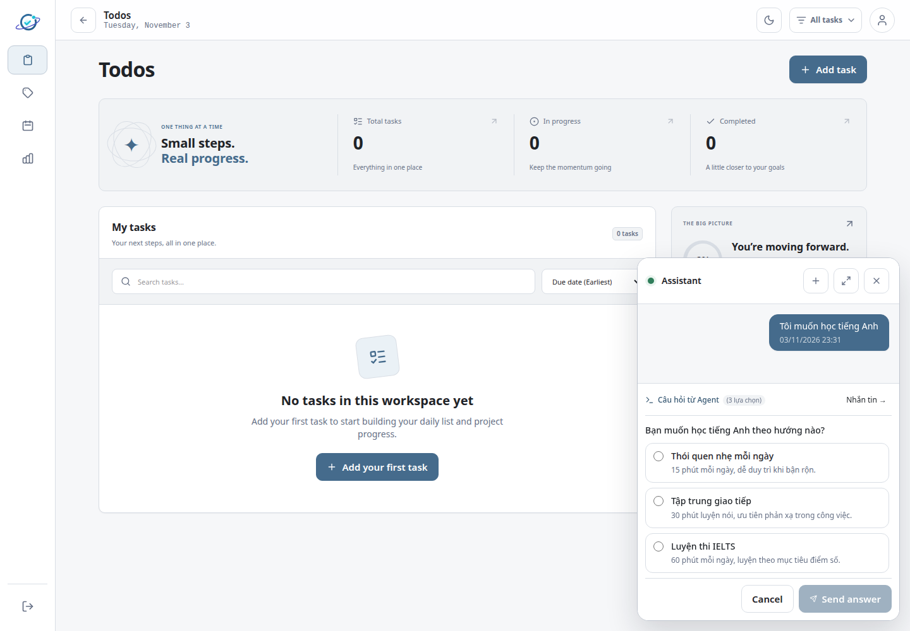

### 02-option-selected

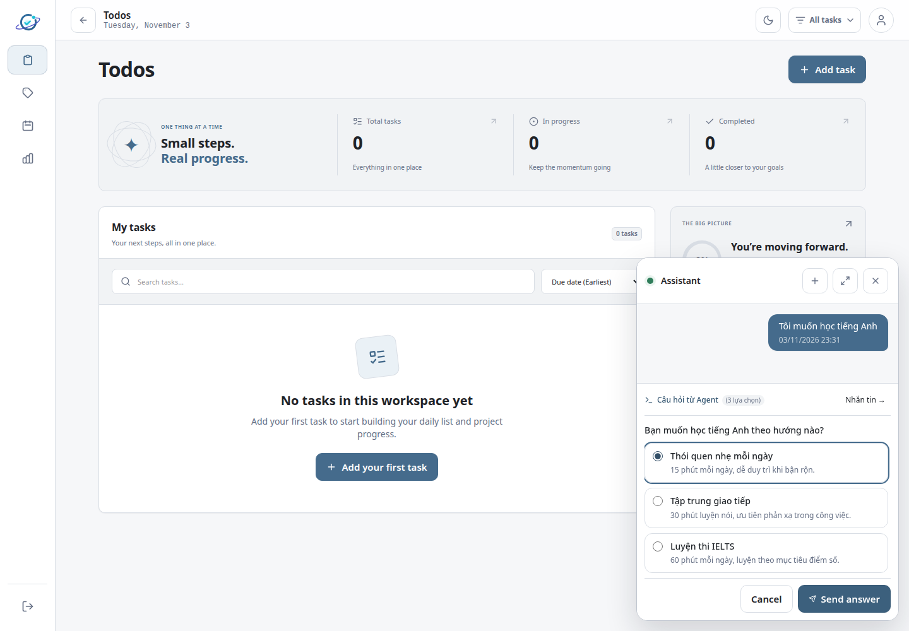

### 03-answer-success


### 04-reload-history

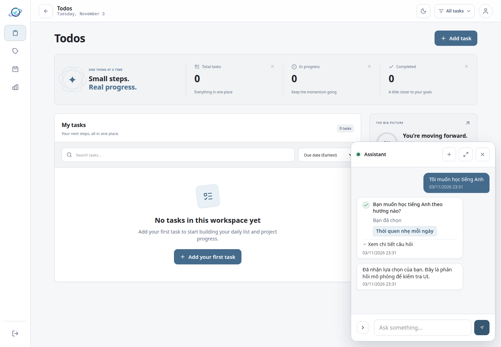

### 05-custom-answer


### 06-message-instead

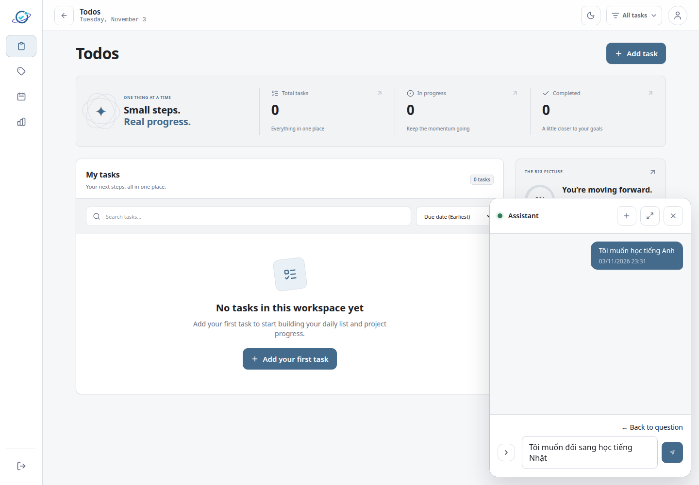

### 07-replaced-question

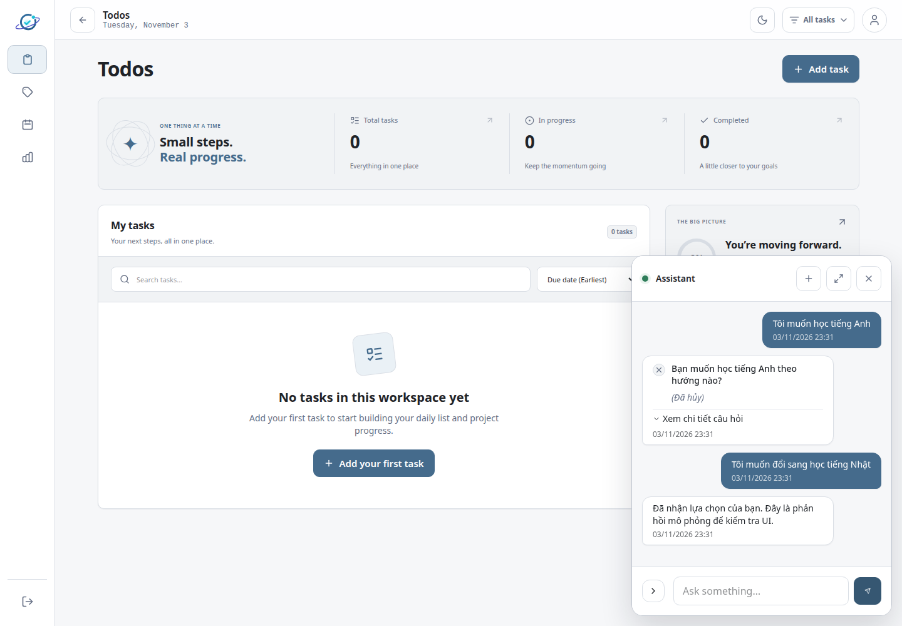

### 08-cancelled


### 09-answer-503

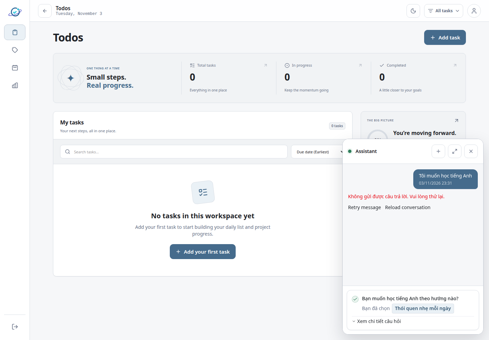

### 10-retry-recovered


### 11-answer-422


### 12-after-reload-422

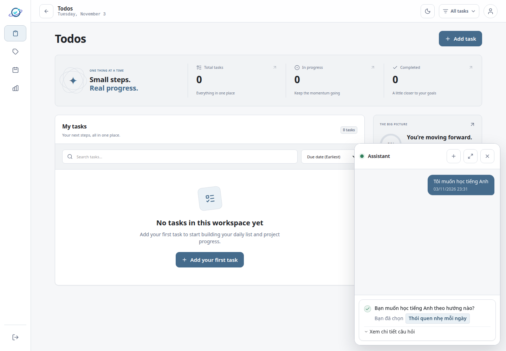

### 13-new-chat-resets-mode

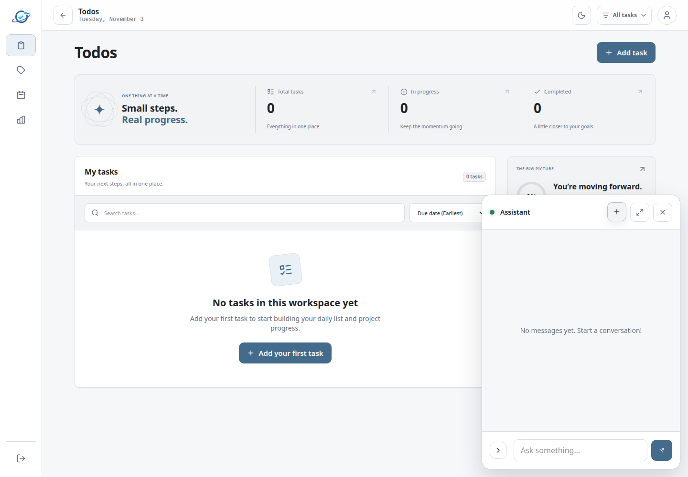

### 14-mobile-ask-question

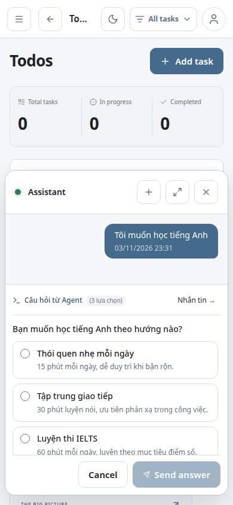

### 15-mobile-custom-answer

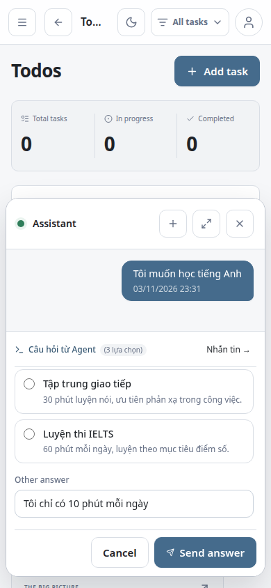

### 16-mobile-answer-success

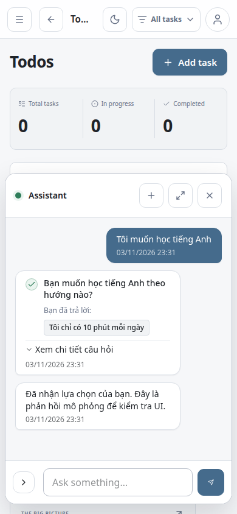

### 17-legacy-confirmation-mobile

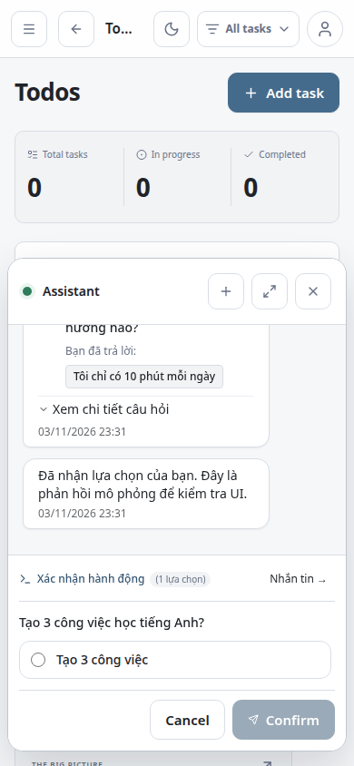

### 18-confirm-success

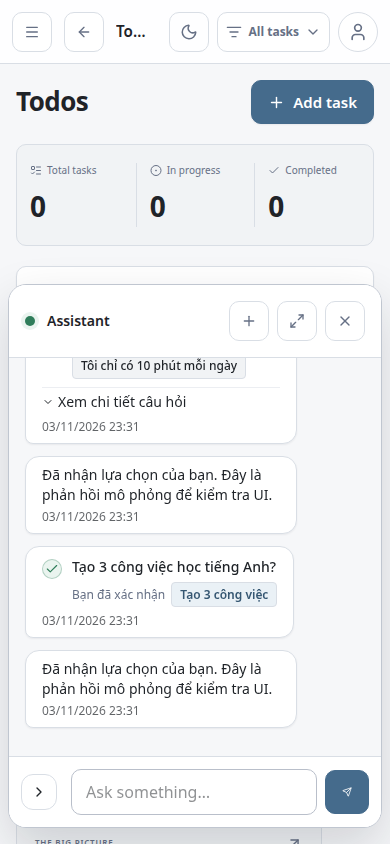

### 19-confirm-cancel

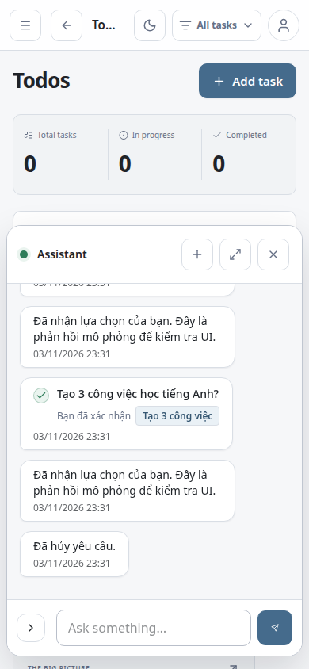
